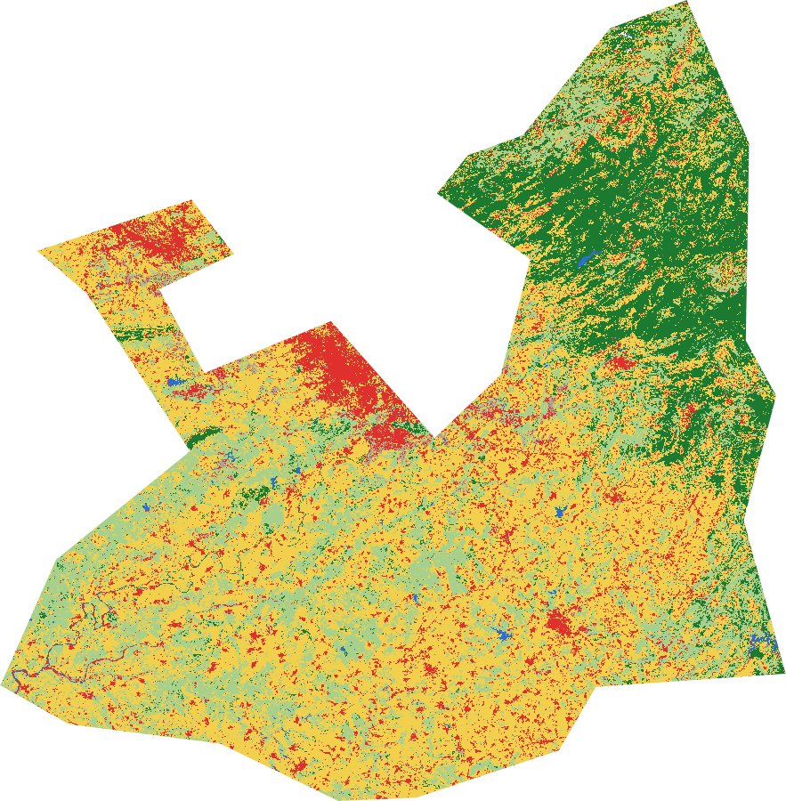
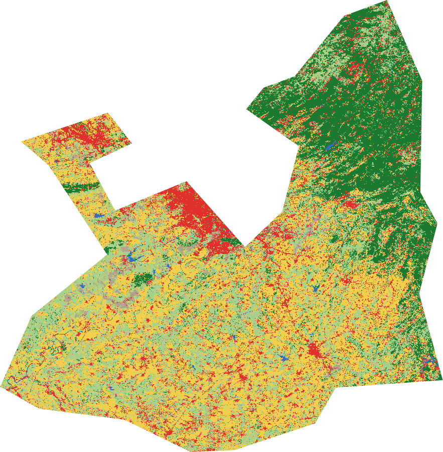
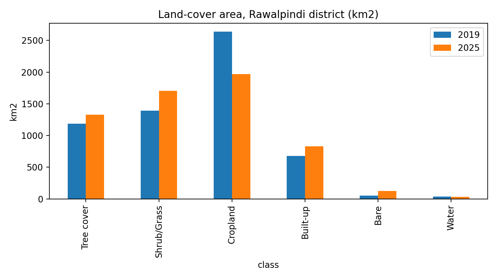
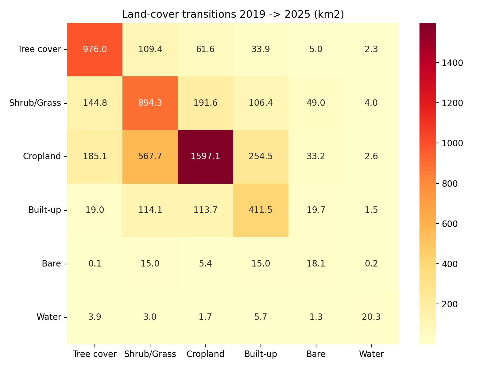
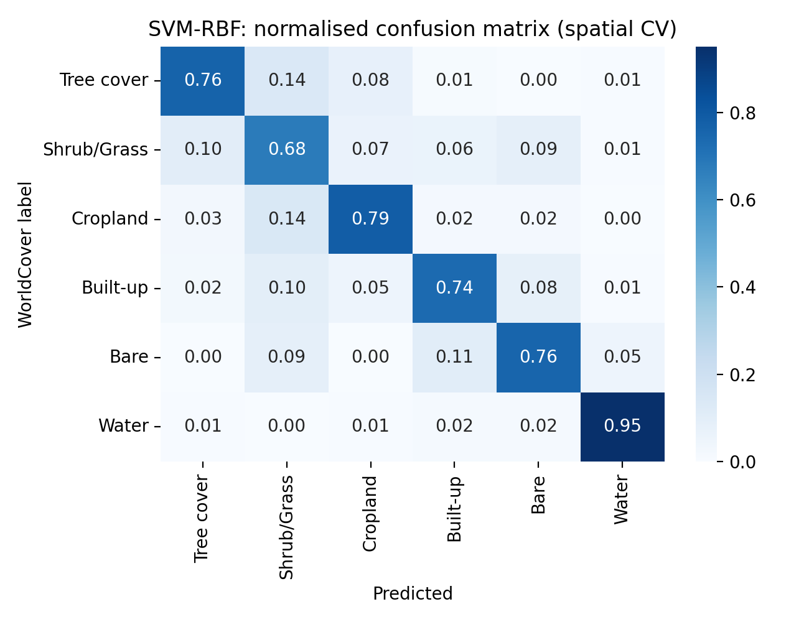

# Urban Expansion in Rawalpindi District (2019–2025): ML Land-Cover Mapping

Machine-learning land-cover mapping of Rawalpindi district to measure how much built-up land grew between 2019 and 2025. Built with **Google Earth Engine**, **Sentinel-2** and **scikit-learn**, using January–April composites, with no manual sampling and no manual downloads.

## Key result

| | 2019 | 2025 | Change |
|---|---|---|---|
| Built-up area | about 680 km² | about 827 km² | **about +22%** |

## Maps

<table>
<tr>
<td align="center"> <b>Land cover, 2019</b></td>
<td align="center"> <b>Land cover, 2025</b></td>
</tr>
</table>

## Charts

### Area change by land-cover class

### Transition matrix (what each class became)

### Confusion matrix (agreement with automatic labels)

Tables behind these charts: [`area_change.csv`](area_change.csv), [`transition_matrix.csv`](transition_matrix.csv) and [`classifier_benchmark.csv`](classifier_benchmark.csv).

## Methods

1. **Classifier benchmark.** Random Forest, Gradient Boosting and SVM were trained on Sentinel-2 bands and indices (NDVI, NDBI, MNDWI), using ESA WorldCover (2021) as automatic labels. Random cross-validation and spatial-block cross-validation (blocks of about 5 km) were compared.
2. **Change mapping.** A Random Forest was trained separately for 2019 and for 2025 using Dynamic World labels, then applied to each year's composite.
3. **Statistics.** Area statistics and a transition matrix were calculated from the two maps.

## Classifier benchmark

| Classifier | Accuracy (agreement with WorldCover labels) |
|---|---|
| SVM (RBF) | 0.78 (spatial cross-validation) |
| Random Forest | 0.75 |
| Gradient Boosting | 0.75 |

Random and spatial cross-validation gave nearly the same accuracy (gap of 0.002 to 0.004). In this setup, spatial autocorrelation did not noticeably inflate the scores.

## Lessons from my first attempt

My first approach showed an implausible **decrease** in built-up land (about −24%). On review, the cause was a classifier trained on 2021 labels being reused for other years. I changed the method to train a separate model for each year, which gave the result above.

## Limitations

- The labels are automatic (WorldCover and Dynamic World) and contain errors. There is no field validation.
- Accuracy in the benchmark measures agreement with these labels, not true accuracy. The final maps were not independently validated.
- Absolute areas depend on method choices. Changes in cropland and bare land are probably affected by seasonal and label noise.
- Only January–April imagery was used.

## Future work

- Independent validation points from high-resolution imagery
- Seasonal composites
- Deep-learning segmentation
- Projection of future urban growth

## Repository contents

| File | What it is |
|---|---|
| `Project2_Urban_Expansion_LULC_ML_clean.ipynb` | Full notebook (code and results) |
| `lulc_2019.png`, `lulc_2025.png` | Land-cover maps |
| `area_change.png`, `area_change.csv` | Area by class and change |
| `transition_matrix.png`, `transition_matrix.csv` | Class transitions, 2019 to 2025 |
| `confusion_matrix.png` | Confusion matrix |
| `classifier_benchmark.csv` | Classifier comparison scores |

## How to run

1. Open `Project2_Urban_Expansion_LULC_ML_clean.ipynb` in Google Colab.
2. Sign in to Google Earth Engine when asked (a free Earth Engine account is needed).
3. Choose Runtime, then Run all.

## Data sources

- Sentinel-2 imagery through Google Earth Engine (Copernicus programme)
- ESA WorldCover 10 m 2021: Zanaga, D. et al. (2022)
- Dynamic World: Brown, C. F. et al. (2022). *Scientific Data*, 9, 251

Author: Malaika Noor
